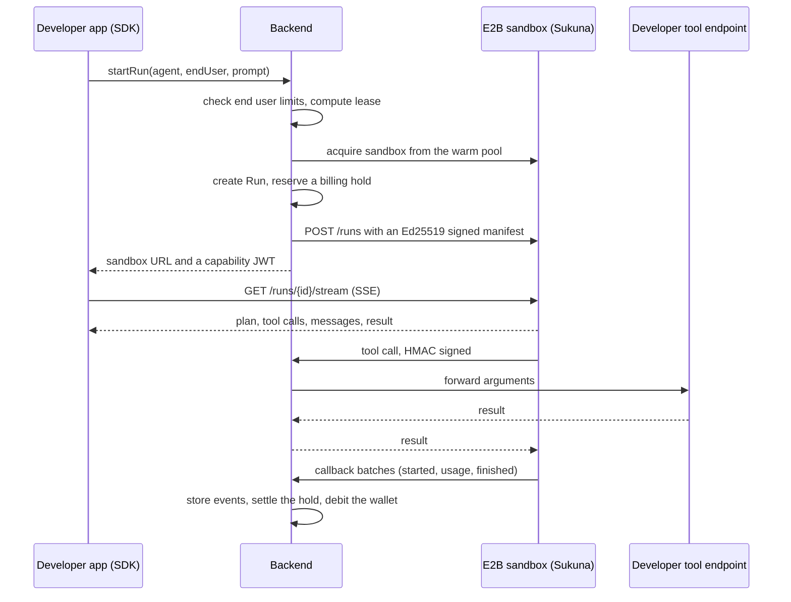

# sukuna-headless

The Midsphere managed agents API. A developer creates an agent, registers their own users, and starts runs for them with one call. Each run executes Sukuna, Midsphere's general agent, inside its own cloud sandbox. The developer gets a live event stream, per-user limits and a bill in prepaid credits.

The repo holds the control plane, the dashboard and two SDKs.

| Part | What it is | Size |
|---|---|---|
| `packages/backend` | Django 6 and Strawberry GraphQL control plane | 13 apps, 29 models, 49 mutations, 949 tests |
| `packages/frontend` | Astro 6 dashboard | 14,000 lines, Playwright and axe checks |
| `packages/sdk-ts` | `@midsphere/sdk` for Node, browsers and edge runtimes | 61 tests |
| `packages/sdk-py` | `midsphere` for Python, async first | 96 tests |

Midsphere AI wound down in 2026. This is published as it was and is not maintained.

## What the API offers

Everything goes through one GraphQL endpoint, `POST /graphql/`, with a workspace API key (`Authorization: Bearer ms_...`) or a dashboard session.

- Agents: create, update, clone, activate, deactivate, attach tools and knowledge. Each agent has a model tier (`free`, `pro`, `enterprise`).
- End users: the developer passes IDs from their own auth system. Each end user has a control profile with credits, a credit refresh period, a concurrency cap, a sandbox time limit, a model tier, and allowed tools and knowledge.
- Tools: a JSON schema and an `execution_endpoint` on the developer's server. The agent calls the tool, the backend forwards the call.
- Knowledge: documents, datasets and connected sources. The agent gets a `search_knowledge` tool.
- Policies: workspace rules the agent follows on every run.
- Runs: `startRun`, `wakeForRun`, `refreshSandboxToken`, run and conversation queries, an event timeline, and 1 to 5 ratings.
- Schedules: cron runs with no user present.
- Billing: a credit wallet per workspace, top-ups through Dodo Payments, a ledger, holds and a rate card per model tier.
- Workspaces: members with admin, editor and viewer roles, invitations, ownership transfer.
- API keys: hashed at rest, scoped (`runs:write`, `agents:read` and nine more), revocable.
- Insights: findings about usage, cost and ratings that can be pinned or dismissed.

REST is used only where GraphQL does not fit:

| Path | Purpose |
|---|---|
| `/auth/signup/`, `/auth/login/`, `/auth/logout/`, `/auth/me/` | dashboard sessions |
| `/auth/verify-email/`, `/auth/resend-verification/`, `/auth/forgot-password/`, `/auth/reset-password/` | account email flows |
| `/webhooks/dodo/` | payment webhooks |
| `/webhooks/sandbox/callbacks` | signed run callbacks and the tool and knowledge proxy |
| `/healthz`, `/readyz` | probes |

## How a run works



1. Create. `startRun` checks the end user's control profile: active, credits left, under the concurrency cap, allowed to use the requested tools, knowledge and model tier. A denial comes back as a typed error.
2. Lease. The backend computes a lease for the run: maximum runtime, maximum tokens and maximum cost. The cost ceiling is the smaller of the wallet's available balance and 50 USD.
3. Sandbox. A sandbox comes from a pool of pre-warmed E2B sandboxes built from the `sukuna-sandbox` template. A conversation that already has a paused sandbox resumes it, so follow-up turns keep their files and state.
4. Hold. A `BillingHold` reserves the lease cost on the wallet inside a row lock, so concurrent runs cannot spend the same credits.
5. Manifest. The backend builds a run manifest (prompt, agent config, tools, knowledge, policies, lease, callback URL), signs it with Ed25519 and posts it to the sandbox. The sandbox verifies the signature before it starts. A fresh 32 byte callback secret is generated per run and stored encrypted with Fernet.
6. Stream. The caller receives the sandbox URL and a 30 minute EdDSA capability JWT scoped to that one run. The SDK streams server-sent events straight from the sandbox, so the backend is never in the token path. The same JWT allows cancel (`DELETE /runs/{id}`) and human-in-the-loop answers (`POST /runs/{id}/hitl/{requestId}`). In production a Caddy wildcard proxy fronts the sandboxes at `{sandbox_id}.run.<domain>`.
7. Tools and knowledge. The sandbox never calls a developer's server directly. It sends an HMAC signed request to the backend, which forwards tool calls to the tool's `execution_endpoint` or runs the knowledge search and returns the chunks.
8. Callbacks. The sandbox posts HMAC signed batches of events. The backend verifies each batch, stores every event once (sequence numbers plus a unique constraint make replays harmless), and projects status, tokens and cost onto the run.
9. Billing. Cost is priced from a rate card per model tier: input tokens per 1k, output tokens per 1k, and a fee per tool call. On the terminal event the hold settles for the actual cost and the wallet is debited. A failed run releases the hold and costs nothing. The sandbox is paused for the next turn.
10. Cleanup. Eleven periodic Celery tasks keep state honest: orphan run reaper, idle sandbox sweep, stale approval reaper, callback gap detector, pool pre-warmer, sandbox state reconcile, hold reconcile, payment reconcile, schedule tick, end user credit refresh and a nightly reconciliation.

What runs underneath: Sukuna on the Exo agent framework, inside an E2B microVM. The `free` tier runs a direct executor. `pro` and `enterprise` add a planner.

## SDK

```ts
import { Midsphere } from '@midsphere/sdk';

const client = new Midsphere({ apiKey: process.env.MIDSPHERE_API_KEY! });

const user = await client.endUsers.ensure({ externalUserId: 'auth0|abc123', tierLabel: 'pro' });
const run = await client.run({ agentId, endUserId: user.id, prompt: 'Summarize today\'s signups' });

for await (const event of run.stream()) {
  console.log(event.type, event.payload);
}
```

The Python SDK mirrors it with `async for event in run.stream()`. The TypeScript package also ships a `useAgent` React hook. See `packages/sdk-ts/README.md` and `packages/sdk-py/README.md`.

`examples/` has three notebooks: a quickstart over the whole SDK, a features tour (model tiers, custom tools, knowledge, policies) with recorded output, and production patterns (streaming consumer, concurrent fan-out, quotas, cost analytics).

## Layout

```
packages/backend/     Django project: config/, integrations/ (E2B, Dodo), apps/
  apps/               accounts, agents, api_keys, billing, core, end_users, insights,
                      knowledge, policies, runs, schedules, tools, workspaces
packages/frontend/    Astro dashboard
packages/sdk-ts/      TypeScript SDK and React hook
packages/sdk-py/      Python SDK
examples/             notebooks and a demo tool and knowledge server
deploy/caddy/         wildcard reverse proxy for sandbox streams
deploy/digitalocean/  App Platform spec and operations notes
context/              product spec, data model, business rules, UI mockups, build log
docs/                 coding standards, design system, backend and sandbox contract notes
scripts/              demo seed and smoke test
dev-up.sh             one command local stack
```

## Setup

You need Docker, uv, Node 18 or newer, cloudflared, an E2B API key and the sandbox template built from the sukuna-sandbox repo.

```bash
cp packages/backend/.env.example packages/backend/.env   # fill in the keys below
./dev-up.sh
```

`dev-up.sh` starts Postgres and Redis, opens a cloudflared tunnel so the sandbox can reach the backend, runs migrations, seeds a demo workspace with an agent, an end user, credits and a new API key, starts the backend on `:8010` and the dashboard on `:4321`, and writes `examples/midsphere.env` for the notebooks. `./dev-up.sh stop` stops everything.

Tests and checks:

```bash
cd packages/backend && uv run pytest && uv run ruff check . && uv run mypy .
cd packages/sdk-py && uv run pytest
cd packages/sdk-ts && npm test
cd packages/frontend && npm run check
```

## Environment variables

Read by `packages/backend/config/runtime.py`. The full list with defaults is in `packages/backend/.env.example`.

| Variable | Purpose |
|---|---|
| `SECRET_KEY`, `DATABASE_URL`, `REDIS_URL` | Django, Postgres, Redis |
| `E2B_API_KEY`, `E2B_TEMPLATE_ID` | sandbox provider and template |
| `SANDBOX_SERVER_API_KEY` | key the sandbox agent server expects |
| `MIDSPHERE_MANIFEST_KEY_ID`, `MIDSPHERE_MANIFEST_PRIVATE_KEY` | Ed25519 key that signs run manifests |
| `MIDSPHERE_JWT_KEY_ID`, `MIDSPHERE_JWT_PRIVATE_KEY` | Ed25519 key that signs capability JWTs |
| `FERNET_ENCRYPTION_KEY` | encrypts per-run callback secrets at rest |
| `BACKEND_PUBLIC_URL` | public URL the sandbox calls back to |
| `SANDBOX_DOMAIN` | wildcard domain in front of sandboxes, empty locally |
| `DODO_API_KEY`, `DODO_WEBHOOK_KEY`, `DODO_CREDIT_PRODUCT_IDS` | credit top-ups |
| `SENTRY_DSN`, `POSTHOG_API_KEY`, `OTEL_EXPORTER_OTLP_ENDPOINT` | optional observability |
| `USE_OBJECT_STORAGE`, `SPACES_*` | optional S3 compatible file storage |

The sandbox template carries the matching public keys under the same key IDs. Generate the key material once:

```bash
python -c "import base64;from cryptography.hazmat.primitives.asymmetric.ed25519 import Ed25519PrivateKey as K;from cryptography.hazmat.primitives import serialization as s;k=K.generate();print('priv',base64.b64encode(k.private_bytes(s.Encoding.Raw,s.PrivateFormat.Raw,s.NoEncryption())).decode());print('pub ',base64.b64encode(k.public_key().public_bytes_raw()).decode())"
python -c "from cryptography.fernet import Fernet;print(Fernet.generate_key().decode())"
```

## Related

- [sukuna-sandbox](https://github.com/hyprcat/sukuna-sandbox): the agent runtime that runs inside each sandbox
- [exo](https://github.com/midsphere-ai/exo): the agent framework under Sukuna
- [sukuna-agent-benchmarks](https://github.com/midsphere-ai/sukuna-agent-benchmarks): benchmark runs for Sukuna

## Licence

[MIT](LICENSE). Free to use, change, self-host and build on, including commercially. Bundled fonts are listed in `NOTICE.md`.

Thanks to Django, Strawberry, Astro, E2B and Caddy.
